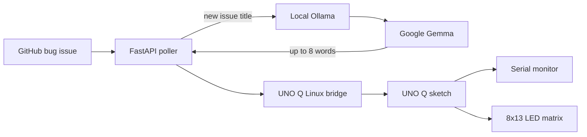

# Ghost in the Machine

A haunted Arduino UNO Q that gives new GitHub bug reports a voice. The FastAPI
service polls this repository's open issues labeled `bug`, asks a Google Gemma
model served locally by Ollama for a cryptic critique, and returns at most
eight words. On the UNO Q, the message appears in Serial and scrolls across the
built-in 8×13 LED matrix.

The spirit only speaks when a new bug-labeled issue appears. The first
successful poll after server startup processes the newest matching issue by
default; later polls return `dormant` until a newer issue is opened.

## Architecture



GitHub is the only external service used at runtime. Issue text is sent to
Ollama on the local computer, not to a hosted model API. The UNO Q's Linux MPU
handles Wi-Fi and HTTP; its STM32 MCU runs the sketch and drives the matrix.

## Requirements

- Python 3.10 or later
- [Ollama](https://ollama.com/) with a Gemma model downloaded
- Arduino UNO Q with Arduino App Lab / UNO Q board support
- The UNO Q and computer running FastAPI on the same trusted local network

The server defaults to `gemma3:4b`, a smaller model option. For the live demo,
the model installed on the developer's computer is `gemma4:26b`; select it
with `OLLAMA_MODEL=gemma4:26b`. Larger models need substantially more memory
and may take longer to answer.

## Run the FastAPI server

From the project directory, create a virtual environment and install the
dependencies:

```bash
python -m venv .venv
```

Activate it (`.venv\Scripts\Activate.ps1` in PowerShell, or
`source .venv/bin/activate` on macOS/Linux), then:

```bash
python -m pip install -r requirements.txt
ollama pull gemma3:4b
```

Start Ollama if it is not already running. Optionally select the installed
model and start the API:

```powershell
# PowerShell; choose a model tag that exists in `ollama list`.
$env:OLLAMA_MODEL = "gemma3:4b"
python -m uvicorn server:app --host 0.0.0.0 --port 8000
```

On macOS/Linux, set the model with `export OLLAMA_MODEL=gemma3:4b` before
starting Uvicorn. To use the already-downloaded `gemma4:26b` model instead,
set `OLLAMA_MODEL` to that tag. The first model response may be slow while
Ollama loads the model into memory.

Check `http://localhost:8000/health` for service health. To trigger a haunting,
open a **new issue** in this repository and apply the `bug` label. The endpoint
is `GET /haunt`; it returns plain text: a Gemma critique for a new issue, or
`dormant` when there is no new issue. The server sees issues when the endpoint
is polled; the UNO Q sketch polls it every 10 seconds.

Optional environment variables:

| Variable | Default | Purpose |
| --- | --- | --- |
| `OLLAMA_HOST` | `http://localhost:11434` | Local Ollama server URL |
| `OLLAMA_MODEL` | `gemma3:4b` | Installed Ollama model tag |
| `GITHUB_TOKEN` | Unset | Optional token for GitHub API rate limits |
| `HAUNT_ON_STARTUP` | `true` | Set to `false` to seed the issue cache silently |
| `SERVER_HOST` | `0.0.0.0` | Uvicorn bind address when running `python server.py` |
| `SERVER_PORT` | `8000` | Uvicorn port when running `python server.py` |

`GITHUB_TOKEN` is not required for this public, read-only endpoint. Never
commit credentials. Keep port 8000 restricted to a trusted LAN with host
firewall rules; do not expose this unauthenticated demo service to the public
internet.

## Run on Arduino UNO Q

1. Connect the UNO Q to Wi-Fi through Arduino App Lab or its Linux environment.
   The Wi-Fi credentials belong on the board's Linux side, not in the sketch.
2. Find the computer's private LAN IPv4 address and set `SERVER_URL` in
   `python/main.py` to `http://<computer-lan-ip>:8000/haunt`.
3. Keep the computer's FastAPI service bound to `0.0.0.0:8000` and allow that
   port through its firewall only on the trusted local network.
4. Open this App Lab project and run the Python helper and UNO Q sketch.
   `sketch/sketch.ino` is the App Lab sketch copy; `ghost_trigger.ino` is also
   provided at the repository root.
5. Open the App Lab Serial monitor. New critiques are printed there and
   scrolled across the built-in LED matrix. The sketch polls every 10 seconds.

The board helper accepts only a private LAN IPv4 URL on port 8000, refuses
redirects, and validates the plain-text response before forwarding it to the
sketch. Serial output remains available if the matrix is not visible.

## Tests

Run the UNO Q bridge helper tests from the project directory:

```bash
python -B -m unittest discover -s tests -p test_uno_q_bridge.py -v
```

These tests cover response validation, the eight-word limit, network errors,
and a local HTTP GET/redirect check. They do not require a UNO Q or live
GitHub/Ollama service. Hardware compilation and an end-to-end physical demo
must be checked with the board.

## License

Unless otherwise noted, the project source code is released under the
[MIT License](LICENSE). Gemma model weights are downloaded separately; they are
not included in this repository. Review the model's own terms before
redistributing its weights.
